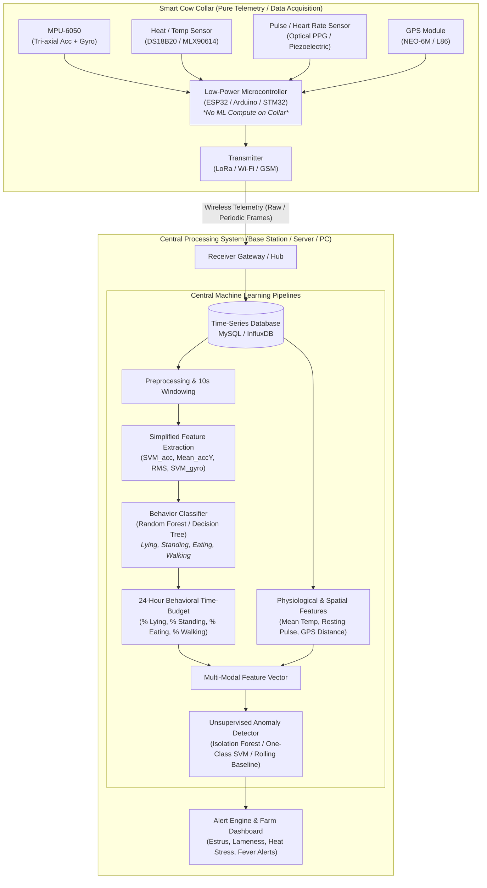

# Research Objectives and Implementation Roadmap
## Project: Smart Cow Collar Telemetry System for Multi-Sensor Health Monitoring, Behavior Classification, and Unsupervised Anomaly Detection

**Target Degree:** 7th Semester Minor Research Project / Engineering Thesis  
**Domain:** IoT in Precision Livestock Farming (PLF), Centralized Machine Learning, Telemetry, and Anomaly Detection  

---

## 1. Project Background and System Architecture

Automated dairy cow monitoring is transforming livestock farming by replacing manual, error-prone visual inspection with continuous telemetry. Rather than placing computationally heavy algorithms on the wearable device—which severely drains collar battery life and increases hardware cost—this project employs a **pure telemetry collar** paired with a **centralized processing system** (local farm base station, PC, or cloud server).

### System Topology: Data Acquisition Collar to Central ML System

---

## 2. Research Objectives (RO)

### Objective 1 (RO1): Design and Integration of the Multi-Sensor Telemetry Collar
* **Goal:** Develop a lightweight, robust, neck-mounted collar that collects synchronized kinematic, physiological, and spatial data and transmits it to a separate central system.
* **Sensor Modalities:**
  1. **MPU-6050 6-Axis IMU**: Tri-axial accelerometer ($a_x, a_y, a_z$) and tri-axial gyroscope ($\omega_x, \omega_y, \omega_z$) for kinematic motion.
  2. **Temperature Sensor (DS18B20 / MLX90614)**: Measures skin contact or collar temperature to identify fever, hypothermia, and environmental heat stress.
  3. **Pulse Sensor**: Optical photoplethysmography (PPG) or acoustic/piezoelectric pulse sensor to monitor resting heart rate.
  4. **GPS Module (NEO-6M)**: Captures location coordinates, grazing travel distance, and pasture geofencing adherence.
* **Firmware Responsibility**: The collar microcontroller performs **zero machine learning inference**. Its sole task is stable sensor acquisition, calibration, periodic frame packaging, and low-power wireless transmission.

---

### Objective 2 (RO2): Simplified Inertial Behavior Classification on Central System
* **Goal:** Automatically classify four fundamental cow behaviors—**Lying**, **Standing**, **Eating/Feeding**, and **Walking**—on the central computer.
* **Methodology (Streamlining Pongsanun et al., 2025):**
  - While Pongsanun et al. computed 79 complex features per window, our central pipeline distills this to **8–10 high-impact, interpretable features**:
    1. $\text{Mean}(a_y)$: Vertical posture inclination (isolates lying down vs. standing/eating).
    2. $\text{SVM}_{\text{acc}} = \sqrt{a_x^2 + a_y^2 + a_z^2}$: Overall linear motion magnitude.
    3. $\text{RMS}(a_y)$: Root-mean-square kinetic energy along the vertical axis.
    4. $\text{Sd}(a_x)$: Standard deviation along the forward-backward axis (captures feeding head jerks).
    5. $\text{SVM}_{\text{gyro}} = \sqrt{\omega_x^2 + \omega_y^2 + \omega_z^2}$: Overall angular rotational velocity.
    6. $\text{IQR}(\omega_y)$ and $\text{IQR}(\omega_z)$: Interquartile range of rotational rates (differentiates head-down chewing from linear walking).
    7. $\text{ODBA}$: Overall Dynamic Body Acceleration.
  - **Classifier**: Train a streamlined **Random Forest** (50 estimators, max depth 8) or **Decision Tree** on 10-second sliding windows. This achieves $>90\%$ accuracy on lying/standing and $>80\%$ on eating while running instantly on the server.

---

### Objective 3 (RO3): Unsupervised Anomaly Detection for Cow Health and Reproduction
* **Goal:** Identify abnormalities in cow health and behavior without requiring scarce, hard-to-label disease datasets.
* **Rationale & Literature Basis:**
  - Collecting ground-truth labels for every illness (mastitis, lameness, acidosis, metritis) is impractical on commercial farms.
  - Recent research (e.g., **Guien et al., 2025**; **Achour et al., 2020**) proves that **unsupervised machine learning (such as Isolation Forests)** can establish an individual cow's normal behavioral baseline and flag deviations days before clinical symptoms become visible.
* **Methodology:**
  1. Construct a multi-parametric hourly/daily feature vector for each cow:
     $$X_t = \left[ \%T_{\text{lying}}, \%T_{\text{standing}}, \%T_{\text{eating}}, \%T_{\text{walking}}, \overline{\text{Temp}}, \overline{\text{Pulse}}, \text{Distance}_{\text{GPS}}, \Delta\text{Transitions} \right]$$
  2. Implement an **Isolation Forest (iForest)** and **Rolling Z-Score / Mahalanobis Distance** engine:
     - The model learns the typical diurnal patterns of each individual cow (or herd cohort).
     - Observations that require very few partition splits or fall outside 2.5–3 standard deviations are flagged as anomalies.
  3. **Target Anomaly Profiles**:
     - **Estrus (Heat)**: Sudden spike in walking time ($+200\%$) + marked drop in lying time + elevated pulse/temperature.
     - **Lameness**: Abnormal lying time ($>14\text{ h/day}$) + severe reluctance to walk + extended latency during standing up.
     - **Metabolic / Digestive Disorders**: Significant decline in eating/feeding duration ($<3\text{ h/day}$).
     - **Fever / Systemic Infection**: Sustained temperature elevation ($>39.5^\circ\text{C}$) accompanied by lethargy and tachycardia.

---

### Objective 4 (RO4): Pasture Geofencing and Spatial Mobility Tracking
* **Goal:** Leverage collar GPS telemetry to monitor herd spatial distribution and grazing mobility.
* **Methodology:**
  - Compute cumulative distance walked per grazing session on the central server.
  - Establish a virtual polygon boundary (geofence). Trigger instant notifications if an animal strays outside pasture boundaries.

---

### Objective 5 (RO5): Central Farm Health Dashboard and Automated Alert Engine
* **Goal:** Build an intuitive central monitoring dashboard (using Python Streamlit / Dash or Flask) for farmers and veterinarians.
* **Features:**
  - Real-time display of behavioral time-budgets (diurnal activity bar charts).
  - Continuous vital telemetry graphs (temperature and pulse trends).
  - Automated alert log categorizing detected anomalies by severity (e.g., *Warning: Possible Estrus Detected*, *Critical: High Fever & Lethargy*).

---

## 3. Key Research Papers from the Literature

The system design synthesizes findings from key peer-reviewed studies:

1. **Pongsanun et al. (2025)** (*BMC Veterinary Research*):
   - *Title:* "Classification of individual dairy cow behaviors using accelerometer, gyroscope, and integrated sensor models."
   - *Key Finding:* Demonstrated that fusing tri-axial accelerometer and gyroscope data significantly improves classification over single-sensor approaches, especially for rotational head movements during eating and walking.
2. **Guien et al. (2024 / 2025)** (*arXiv / Precision Livestock Farming*):
   - *Title:* "Detection of anomalies in cow activity using wavelet transform based features and Isolation Forest."
   - *Key Finding:* Proved that unsupervised anomaly detection using **Isolation Forest** on cow collar activity time-series detects sickness and estrus events days before human herdsmen notice visual signs.
3. **Achour et al. (2019 / 2021)** (*Computers and Electronics in Agriculture*):
   - *Title:* "Unsupervised automated behavior monitoring using inertial sensors."
   - *Key Finding:* Demonstrated that unsupervised clustering and density-based outlier detection effectively model normal cattle behavioral routines without requiring manual ground-truth labeling for pathologies.
4. **Kovács et al. (2014, 2019)** (*Journal of Dairy Science*):
   - *Key Finding:* Established that heart rate (pulse) and heart rate variability (HRV) serve as early physiological biomarkers for acute stress, pain, and impending systemic disease in dairy cattle.
5. **Arcidiacono et al. / Benaissa et al. (2020, 2022)** (*Sensors / Biosystems Engineering*):
   - *Key Finding:* Confirmed that integrating GPS tracking with accelerometer and temperature data enables robust lameness detection and pasture welfare monitoring.

---

## 4. Work Breakdown & Implementation Matrix

| Phase | Milestone | Key Activities | Output / Deliverable |
| :--- | :--- | :--- | :--- |
| **Phase 1** | **Dataset & Feature Selection** | Load `cow_data_processed_updated.csv`. Extract the lean 8–10 feature subset. Compare accuracy against the full 79-feature set. | Optimized feature extraction script (`extract_lean_features.py`). |
| **Phase 2** | **Central Behavior Classifier** | Train Random Forest and Decision Tree on the 4 primary behaviors (`lying`, `standing`, `eating`, `walking`). | Trained model artifact (`behavior_rf_model.pkl`) with $>88\%$ accuracy. |
| **Phase 3** | **Unsupervised Anomaly Model** | Implement Isolation Forest and Mahalanobis baseline on behavioral time-budgets combined with simulated/real vitals (temp, pulse). | Anomaly detection module (`anomaly_detector.py`) flagging estrus, fever, and lameness. |
| **Phase 4** | **Collar Hardware Prototyping** | Connect ESP32, MPU-6050, DS18B20, Pulse Sensor, and NEO-6M GPS. Implement pure data reading and wireless transmission. | Collar firmware (`collar_transmitter.ino`). |
| **Phase 5** | **Central Receiver & Ingestion** | Build Python receiver script (MQTT / Serial / HTTP) to parse incoming collar packets and store them in database. | Server ingestion pipeline (`data_ingestion.py`). |
| **Phase 6** | **Dashboard & Documentation** | Build interactive Streamlit dashboard. Finalize 7th-semester thesis report and project presentation. | Web dashboard (`app.py`) and project documentation. |
