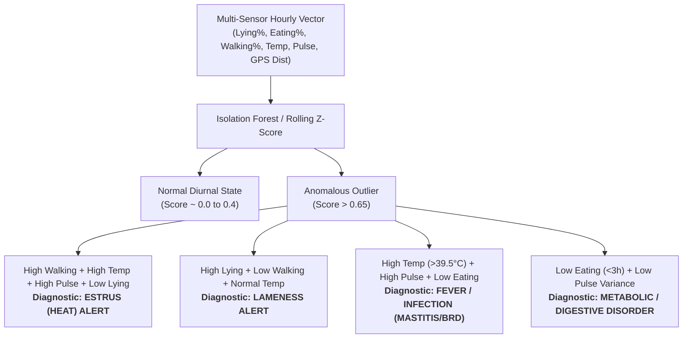

# Smart Cow Collar: Sensor Suite Specifications and Roles

This document details the complete suite of sensors integrated into the **Smart Cow Collar Telemetry Tag**, explaining their specifications, physical placement, physiological baselines, and dedicated roles in behavior classification and unsupervised health anomaly detection.

---

## 1. Comprehensive Sensor Suite Overview

| Sensor | Component Model | Hardware Interface | Measurement Parameters | Sampling / Reporting Rate | Key Functional Role |
| :--- | :--- | :--- | :--- | :--- | :--- |
| **Motion / Kinematics (IMU)** | InvenSense **MPU-6050** | I2C (`SDA`, `SCL`) | 3-axis Acceleration ($a_x, a_y, a_z$), 3-axis Angular Rate ($\omega_x, \omega_y, \omega_z$) | 10 Hz / 50 Hz sampled locally, averaged into 10s windows | Posture & activity classification (Lying, Standing, Eating, Walking) |
| **Body Heat / Temperature** | Maxim **DS18B20** (Waterproof Probe) or Melexis **MLX90614** (Contactless IR) | 1-Wire (GPIO) / I2C | Temperature in $^\circ\text{C}$ ($-55^\circ\text{C}$ to $+125^\circ\text{C}$, $\pm 0.5^\circ\text{C}$ accuracy) | Sampled once per 10s or 1 minute | Detection of fever (pyrexia), heat stress, and pre-calving drop |
| **Pulse / Heart Rate** | **Pulse Sensor Amped** / **MAX30102** (PPG Optical) | Analog ADC / I2C | Beats Per Minute (BPM) & Inter-Beat Intervals (IBI) | Sampled periodically (e.g., 30s per 5 min) | Stress, pain, acute systemic illness, and estrus excitement indicator |
| **Global Positioning (GPS)** | u-blox **NEO-6M** / ATGM336H | UART (`TX`, `RX` @ 9600 baud) | Latitude, Longitude, Ground Speed, UTC Timestamp | Periodic fix (e.g., active for 45s every 15–30 min) | Pasture geofencing, location tracking, and daily distance traveled |
| **Collar Battery Monitor** | Resistor Voltage Divider ($100\text{k}\Omega / 100\text{k}\Omega$) | Analog ADC | Battery voltage (3.0V – 4.2V Li-ion) | Sampled once per telemetry cycle | Collar power diagnostics and low-battery alert |

---

## 2. Detailed Technical Breakdown per Sensor

### 2.1. Motion / Kinematics Sensor: InvenSense MPU-6050 (6-Axis IMU)

#### Physical Placement & Alignment on the Cow
- **Location**: Mounted securely on the right-lateral or upper-dorsal side of the cow’s neck collar. A counterweight (battery pack or weighted buckle) at the base of the collar prevents rotation.
- **Axis Orientation (Matching Pongsanun et al., 2025)**:
  - **X-axis**: Longitudinal (forward–backward, parallel to neck length).
  - **Y-axis**: Vertical (up–down; resting gravitational baseline aligns with $+1\text{g}$ / $-1\text{g}$).
  - **Z-axis**: Lateral (left–right transverse neck movements).

#### What it is Used For:
1. **Static Posture Recognition (Lying vs. Standing)**:
   - When a cow is **lying down**, the neck is positioned lower and more horizontally, shifting the gravitational acceleration vector between the $X$ and $Y$ axes. The overall signal variance is extremely low and stable.
   - When **standing**, the neck is held upright, keeping acceleration along the vertical $Y$-axis close to $1\text{g}$ ($9.8\text{ m/s}^2$).
2. **Dynamic Behavior Recognition (Eating vs. Walking)**:
   - **Eating / Feeding**: Head is angled downward toward the feed bunk/ground, producing distinct oscillatory rotations in **GyroY** and **GyroZ** (angular pitch and yaw) as the animal tears and chews forage.
   - **Walking**: Exhibits cyclical, rhythmic acceleration peaks along the longitudinal $X$-axis combined with rhythmic lateral neck swaying ($Z$-axis).
3. **Role in Telemetry & ML**:
   - The collar computes 10-second axis means or streams raw samples.
   - The central server extracts lean features (e.g., $\text{Mean}(a_y)$, $\text{SVM}_{\text{acc}}$, $\text{SVM}_{\text{gyro}}$, $\text{RMS}(a_y)$) to classify behavior into the 4 target classes.

---

### 2.2. Heat / Body Temperature Sensor: DS18B20 / MLX90614

#### Physiological Reference Range in Dairy Cattle
- **Normal Core Body Temperature**: **$38.0^\circ\text{C}$ to $39.3^\circ\text{C}$** ($100.4^\circ\text{F} - 102.8^\circ\text{F}$)
- **Normal Skin / Neck Surface Temperature**: Typically **$34.0^\circ\text{C}$ to $37.5^\circ\text{C}$** (depends on ambient temperature, calibrated dynamically).

#### What it is Used For:
1. **Early Pyrexia (Fever) & Disease Detection**:
   - A sustained temperature $>39.5^\circ\text{C}$ ($103.1^\circ\text{F}$) indicates the onset of systemic bacterial or viral infections—most notably **Mastitis**, **Metritis**, or **Bovine Respiratory Disease (BRD)**.
   - Studies confirm that temperature elevations precede visible clinical symptoms (such as swollen udders or nasal discharge) by **24 to 48 hours**, enabling early veterinary treatment.
2. **Estrus Detection**:
   - Cows often experience a slight transient rise in body temperature ($0.3^\circ\text{C} - 0.5^\circ\text{C}$) during standing heat (estrus).
3. **Pre-Calving Alert (Parturition)**:
   - A characteristic physiological dip in body temperature of **$0.5^\circ\text{C}$ to $1.0^\circ\text{C}$** occurs approximately 24 to 36 hours prior to the onset of labor.
4. **Heat Stress Evaluation**:
   - Helps evaluate whether cows are experiencing thermal stress during high ambient temperature and humidity, which directly impairs feed intake and milk yield.

---

### 2.3. Pulse / Heart Rate Sensor (Optical PPG / Pulse Sensor Amped)

#### Physiological Reference Range in Dairy Cattle
- **Normal Resting Heart Rate**: **48 to 84 Beats Per Minute (BPM)** (Average adult dairy cow: ~60–72 BPM).

#### Physical Placement on the Animal
- Positioned on the inner lining of the collar with gentle, constant contact against thin, vascularized skin—such as the lower dewlap (throat fold) or behind the base of the ear.

#### What it is Used For:
1. **Acute Pain & Stress Marker**:
   - Severe pain (e.g., severe acute lameness, sole ulcers, abdominal colic) triggers the sympathetic nervous system, causing tachycardia (resting heart rate spiking to **$>90 - 110\text{ BPM}$**).
2. **Systemic Sickness Corroboration**:
   - When a temperature spike (fever) is accompanied by elevated resting heart rate and decreased eating duration, the confidence score for acute infectious disease reaches maximum severity.
3. **Calving & Mating Excitement**:
   - Physical exertion during estrus or calving labor induces elevated heart rate, corroborating behavioral restlessness data.

---

### 2.4. Global Positioning System (GPS): u-blox NEO-6M / ATGM336H

#### What it is Used For:
1. **Virtual Geofencing & Pasture Boundary Alerts**:
   - Farm perimeters are defined as digital GPS polygons on the central system.
   - If a cow strays beyond the boundary fence, the central monitoring station triggers an immediate escape/theft alert.
2. **Daily Mobility & Distance Traveled**:
   - Calculates the cumulative distance walked per cow over 24 hours (typically 2 to 6 km/day for pasture cattle).
   - **Lameness Detection**: A sharp drop in daily distance traveled ($<1.0\text{ km/day}$), coupled with increased lying time ($>14\text{ hours}$), is a primary indicator of lameness.
   - **Estrus Hyperactivity**: A 200–300% surge in distance walked within a 12-hour period strongly indicates estrus.
3. **Grazing Distribution Mapping**:
   - Identifies grazing hotspots and under-utilized pasture zones for rotational grazing management.

---

## 3. How Multi-Sensor Fusion Powers Unsupervised Anomaly Detection

On the central server, the multi-sensor streams are consolidated every hour into an integrated feature vector:

$$\mathbf{X}_{\text{hour}} = \begin{bmatrix} \text{Lying Time (min)} \\ \text{Standing Time (min)} \\ \text{Eating Time (min)} \\ \text{Walking Time (min)} \\ \text{Mean Body Temperature } (^\circ\text{C}) \\ \text{Mean Resting Pulse } (\text{BPM}) \\ \text{GPS Distance Traveled } (\text{meters}) \end{bmatrix}$$

The **Unsupervised Anomaly Engine (Isolation Forest & Rolling Baseline)** evaluates this vector against the cow's own historical norm:

